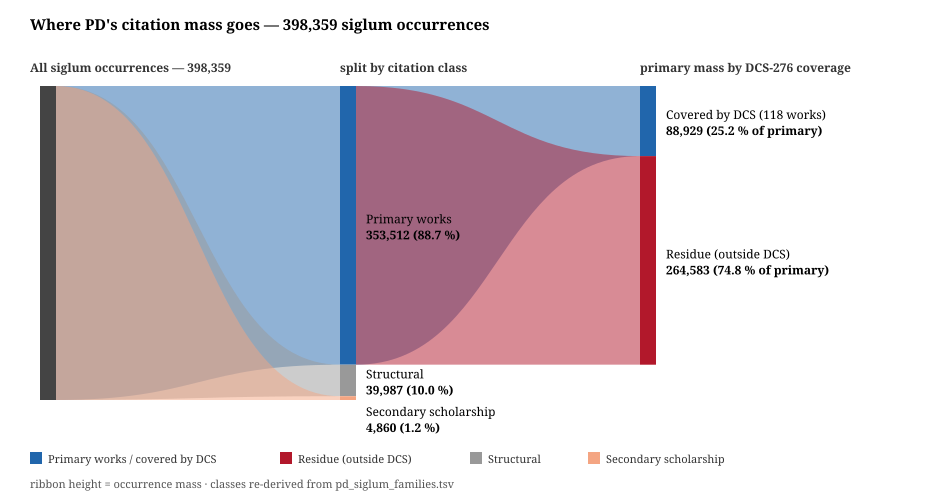

# PD

[](https://doi.org/10.5281/zenodo.23151371)

Front-matter OCR for *An Encyclopaedic Dictionary of Sanskrit on Historical Principles*
(Deccan College / KoshaSHRI).

**Knowledge page:** [`PD_KNOWLEDGE.md`](PD_KNOWLEDGE.md) — sourced facts, measurements, canon
denominators and a do-not-quote list for the dictionary itself, in 8 sections, each carrying an
evidence label (`observed` / `derived` / `inferred` / `reviewed`), plus the canon ledger, three
verbatim entry exhibits and a verification checklist.

**Repo map:** per-PDF OCR extractions (`GA`/`AUB`/`RG`/`AOB`/`SWC` → `.md` + `_ocr.md`), vol.-1
front-matter transcriptions ([`PREFACE.md`](PREFACE.md), [`ES.md`](ES.md), [`IW.md`](IW.md) +
[`IW.tsv`](IW.tsv)), OCR comparison reports
([`COMPARISON_PWG_OCR_A_VS_B.md`](COMPARISON_PWG_OCR_A_VS_B.md),
[`COMPARISON_AOB_OCR_ANTIGRAVITY_VS_GROK.md`](COMPARISON_AOB_OCR_ANTIGRAVITY_VS_GROK.md)) with the
one-off probes they used in [`tests/`](tests/README.md) (run them from the repo root), changelog
guard scripts in [`scripts/`](scripts), press reproductions ([`PRESS/`](PRESS)), agent handoff
notes ([`HANDOFF_OCR_PD.md`](HANDOFF_OCR_PD.md)), citation metadata ([`CITATION.cff`](CITATION.cff)),
the sourced knowledge page and this changelog. Agent/AI contribution rules:
[`AGENTS.md`](AGENTS.md) — PR-only, human merges; rights: [`RIGHTS.md`](RIGHTS.md).

_Created: 23-07-2026 · Last updated: 31-10-2026_

## Sources → Markdown

| PDF | Pages | Content | Output |
|-----|------:|---------|--------|
| `GA.pdf` | 2 | General Abbreviations | [`GA.md`](GA.md) |
| `AUB.pdf` | 2 | Abbreviations Used in the Bibliography | [`AUB.md`](AUB.md) |
| `RG.pdf` | 5 | Reader’s Guide | [`RG.md`](RG.md) |
| `SWC.pdf` | 9 | Subject-wise Classification & Chronology | [`SWC.md`](SWC.md) |
| `AOB.pdf` | 42 | Abbreviations of Books Quoted | [`AOB.md`](AOB.md) |
| — (IA vol. 1 scan) | 28 | Introductory Essay (front matter pp. I-XXVIII) | [`ES.md`](ES.md) |
| — (IA vol. 1 scan) | 39 | Index of Works Used in the Dictionary (pp. LXXXIX-CXXVII) | [`IW.md`](IW.md) · [`IW.tsv`](IW.tsv) |

Baselines from the first OCR pass are kept as `*_ocr.md` for diffing.

**Preface (pp. V–VI).** The printed Preface is not among the KoshaSHRI PDFs. It is
transcribed from the archive.org scan of Vol. 1 (1976), leaves 8–9, as
[`PREFACE.md`](PREFACE.md).

**Introductory Essay (pp. I–XXVIII) and Index of Works (pp. LXXXIX–CXXVII).** No
source PDF for either ships in this repo; both are transcribed from the 2023-06-17
Internet Archive scan of vol. 1
(`mAAY_an-encyclopaedic-dictionary-of-sanskrit-vol-1-critically-edited-by-a-m-ghatage-1`)
with [`parse_pd_frontmatter.py`](parse_pd_frontmatter.py), which pins the source
`djvu.xml` by SHA-256 and emits [`ES.md`](ES.md), [`IW.md`](IW.md), the
[`IW.tsv`](IW.tsv) subject-code × siglum index and
[`pref_manifests/pd_vol1_frontmatter_manifest.tsv`](pref_manifests/pd_vol1_frontmatter_manifest.tsv)
(printed page → scan leaf). The original dictionary `.txt` files are untouched.

**CDSL preface pages (`pe`/`bur` manifests).** [`extract_html_pref.py`](extract_html_pref.py)
pulls preface pages that ship as HTML text layers (not scans) from the CDSL site and records
them as page → image → section → source-URL manifests:
[`pref_manifests/pe_manifest.tsv`](pref_manifests/pe_manifest.tsv) and
[`pref_manifests/bur_manifest.tsv`](pref_manifests/bur_manifest.tsv).

**Additional Abbreviations (p. CXXVIII)** remains outside this pack.

## Pipeline

```text
python run_ocr.py                  # all five PDFs
python run_ocr.py --only GA.pdf    # one file
python run_ocr.py --only AOB.pdf --start-page 20   # resume AOB from page 21
```

**Requirements:** Python 3, Tesseract 5.x with `eng` + `san` traineddata, plus:

```text
pymupdf  pillow  pytesseract  numpy  beautifulsoup4
```

### v2 features (`run_ocr.py`)

1. **Crop-then-OCR** per column strip (not full-page OCR + post-split)
2. **Layout modes**
   - `multi_pair` — key \| expansion tables (GA, AUB); format `` `Abl.` Ablative ``
   - `multi_seq` — Abbreviation \| Title \| Mode (AOB); format `` `Abbr.` Title — Mode ``
   - `prose_2col` — left column then right (RG, SWC)
3. **Italics** from native PDF Times-Italic spans; skew heuristic only as fallback; stopwords banned
4. **Provenance header** + `## Page N` markers
5. **Resume** via `--start-page` / `--end-page`

PDFs are image scans with a partial native text layer (Latin + italics; Devanāgarī is mojibake in the layer). Tesseract `eng+san` supplies Unicode Devanāgarī.

`PREFACE.md` is a one-off transcription and is **not** produced by `run_ocr.py`: Tesseract 5.5.3 supplied a column-cropped base text, which was then collated line by line against the page images.

## CI

| Workflow | Guard |
|----------|-------|
| [`validate.yml`](.github/workflows/validate.yml) | Byte-compile smoke over all Python sources (Python 3.11) on push/PR |
| [`f821-gate.yml`](.github/workflows/f821-gate.yml) | `F821` undefined names only — standalone ruff 0.16.5, version pinned |
| [`changelog-lint.yml`](.github/workflows/changelog-lint.yml) | Changelog integrity: no entry bullet duplicated across release sections ([`scripts/changelog_duplicate_bullets.py`](scripts/changelog_duplicate_bullets.py)); released `## [x.y.z]` headings are append-only ([`scripts/changelog_released_headings.py`](scripts/changelog_released_headings.py)) |
| [`dependabot-auto-merge.yml`](.github/workflows/dependabot-auto-merge.yml) | Auto-approves and auto-merges Dependabot GitHub-Actions bumps (weekly, Mondays) except semver-major |

Everything else lands by PR with a human merge — see [`AGENTS.md`](AGENTS.md).

## About the dictionary

See [`about.md`](about.md) and [`aboutDictionary.md`](aboutDictionary.md) (KoshaSHRI / Deccan College).

## Where the citation mass goes



All 398,359 siglum occurrences of the letter-*a* volumes split into primary-work citations
(353,512 — 88.7 %), structural apparatus and secondary scholarship; of the primary mass, the
118 works held by the Digital Corpus of Sanskrit (DCS-276) absorb 88,929 occurrences
(25.2 %), leaving a 264,583-occurrence residue outside it. Deterministic render from the
committed PD↔DCS crosswalk by the
[csl-atlas figure builder](https://github.com/sanskrit-lexicon/csl-atlas/blob/main/scripts/build_a68_figures.py)
(cross-check gate over `data/pd/`); figure menu and verdicts in the
[A68 visualisation catalogue](https://github.com/gasyoun/Uprava/blob/main/papers/A68/A68_VISUALISATION_CATALOGUE_30_2026-10-31.md).

## Citation

[`CITATION.cff`](CITATION.cff) carries the metadata; the DOI badge above is the Zenodo concept DOI
(always resolves to the latest version). Cite both the digital edition and the printed source it
digitises.

## Rights

Original contributions are [CC BY-SA 4.0](https://creativecommons.org/licenses/by-sa/4.0/legalcode.txt)
([`LICENSE`](LICENSE)); the Cologne machine text,
the printed dictionary and the press witness each keep their own regime. The layering is stated in
[`RIGHTS.md`](RIGHTS.md).

---

_Dr. Mārcis Gasūns_
